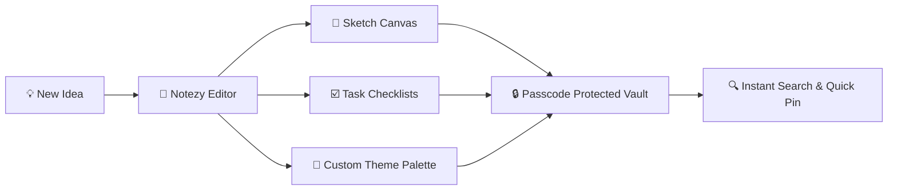

<div align="center">

  <p align="center">
    
  </p>

  # 📝 Notezy
  ### *Your thoughts, organized in one place.*

  A sleek, modern mobile notes application designed for capturing spontaneous ideas, sketching creative thoughts, and keeping your life organized.

  <p align="center">
    <a href="https://github.com/Andinet2123/Notezy/stargazers"></a>
    <a href="https://github.com/Andinet2123/Notezy/network/members"></a>
    <a href="https://github.com/Andinet2123/Notezy/issues"></a>
    <a href="https://github.com/Andinet2123/Notezy/blob/main/LICENSE"></a>
    <a href="https://github.com/Andinet2123/Notezy"></a>
  </p>

  <p align="center">
    <a href="#-screenshots"><b>Screenshots</b></a> •
    <a href="#-features"><b>Features</b></a> •
    <a href="#-design-philosophy"><b>Design</b></a> •
    <a href="#-tech-stack"><b>Tech Stack</b></a> •
    <a href="#-getting-started"><b>Getting Started</b></a> •
    <a href="#-roadmap"><b>Roadmap</b></a>
  </p>

</div>

---

## 📱 Screenshots

<div align="center">
  <p align="center">
    
    &nbsp;&nbsp;&nbsp;&nbsp;&nbsp;&nbsp;
    
  </p>
  <p align="center">
    <b>🏠 Home Screen & Search</b> &nbsp;&bull;&nbsp; <b>✍️ Rich Note Editor</b>
  </p>

  <br />

  <p align="center">
    
    &nbsp;&nbsp;&nbsp;&nbsp;&nbsp;&nbsp;
    
  </p>
  <p align="center">
    <b>🎨 Freehand Sketch Canvas</b> &nbsp;&bull;&nbsp; <b>🌈 Custom Editor Themes</b>
  </p>
</div>

---

## 💡 Notezy Workflow



---

## ✨ Features

| Feature | Highlight | Description |
| :--- | :--- | :--- |
| ✍️ **Create & Edit** | Effortless Writing | Quick capture mode to draft thoughts, memos, and ideas in seconds. |
| 🔍 **Instant Search** | Fast Retrieval | Real-time search query to instantly locate any note or checklist item. |
| 🔒 **Locked Notes** | Privacy First | Secure sensitive personal notes and ideas behind a private passcode. |
| 📌 **Pin & Share** | Quick Actions | Pin your most crucial notes to the top and share content with one tap. |
| 🎨 **Sketch Canvas** | Visual Doodling | Built-in freehand drawing pad with selectable color palettes and adjustable stroke widths. |
| 🌈 **Editor Themes** | Personal Aesthetics | Customize your writing experience with calming warm and modern background tones. |
| ☑️ **Interactive Checklists** | Task Management | Turn thoughts into actionable to-do items with toggleable checkboxes. |
| ⚡ **Clean Interface** | Zero Distractions | Carefully designed layout that puts your typography and writing front and center. |

---

## 🎨 Design Philosophy

Notezy is crafted around visual warmth and focus:
- **Dark Mode Home:** Deep, contrast-rich list screen that reduces eye strain and makes notes pop.
- **Warm Note Cards:** Tactile card surfaces accented with vibrant orange elements.
- **Calming Editor:** Minimalist, glare-free editor canvas with customizable pastel themes for distraction-free writing.

---

## 🛠️ Tech Stack

<div align="center">

| Layer | Technologies |
| :--- | :--- |
| **Frontend / Mobile** |    |
| **Styling & Icons** |   |
| **Local Storage & State** |   |
| **Security** |  |

</div>

> *Tip: You can customize the badges above to match the exact libraries used in your build.*

---

## 🚀 Getting Started

### Prerequisites

Ensure you have the following installed on your development machine:
- [Node.js](https://nodejs.org/) (v18.0.0 or higher)
- [npm](https://www.npmjs.com/) or [yarn](https://yarnpkg.com/)
- [Git](https://git-scm.com/)
- [Expo Go](https://expo.dev/go) app on your physical device (or Android Studio / Xcode emulator)

### Installation

1. **Clone the repository:**
   ```bash
   git clone https://github.com/Andinet2123/Notezy.git
   cd Notezy
   ```

2. **Install project dependencies:**
   ```bash
   npm install
   ```

3. **Start the development server:**
   ```bash
   npx expo start
   ```

4. **Launch the app:**
   - Scan the QR code with **Expo Go** (Android) or the **Camera App** (iOS).
   - Or press `a` for Android Emulator / `i` for iOS Simulator.

---

## 📁 Project Structure

```text
Notezy/
├── assets/
│   └── screenshots/          # App icon & preview screenshots
│       ├── app-icon.jpg
│       ├── home.jpg
│       ├── note-editor.jpg
│       ├── sketch-canvas.jpg
│       └── editor-themes.jpg
├── src/
│   ├── components/           # NoteCard, ColorPicker, CanvasBar, Header
│   ├── screens/              # HomeScreen, EditorScreen, CanvasScreen, LockScreen
│   ├── hooks/                # useNotes, useCanvas, usePasscode
│   ├── storage/              # SQLite / AsyncStorage persistence
│   └── styles/               # Color themes and global design tokens
├── package.json
└── README.md
```

---

## 🗺️ Roadmap

- [x] Rich text writing & note editing
- [x] Freehand sketch canvas with line width and color palette
- [x] Custom writing background theme selector
- [x] Passcode lock for confidential notes
- [ ] Biometric unlock (Fingerprint / FaceID)
- [ ] Audio voice-memo attachments
- [ ] Cloud sync & backup (Google Drive / iCloud)
- [ ] Export notes to PDF and Markdown

---

## 🤝 Contributing

Contributions make the open-source community thrive! Any bug fixes, feature proposals, or design enhancements are welcome.

1. Fork the Project
2. Create your Feature Branch (`git checkout -b feature/AmazingFeature`)
3. Commit your Changes (`git commit -m 'feat: Add AmazingFeature'`)
4. Push to the Branch (`git push origin feature/AmazingFeature`)
5. Open a Pull Request

---

## 📄 License

Distributed under the **MIT License**. See [`LICENSE`](LICENSE) for more details.

---

<div align="center">

  Crafted with ❤️ by **[Andinet Yohannes](https://github.com/Andinet2123)**

  <p align="center">
    <a href="https://github.com/Andinet2123"></a>
  </p>

  ⭐ *If you find Notezy useful, don't forget to star the repository!*

</div>
