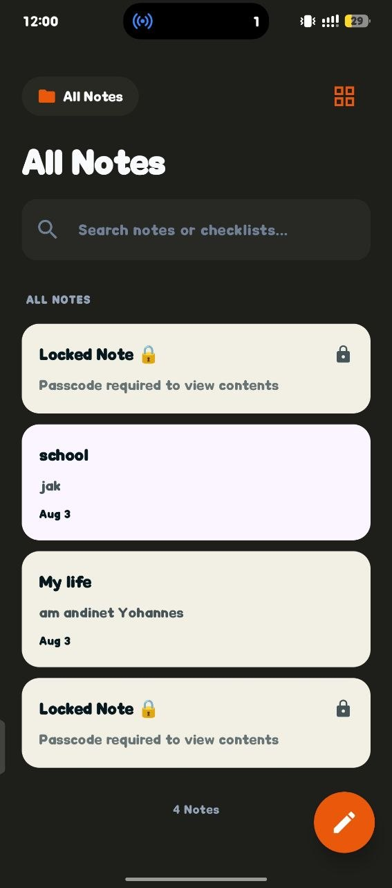
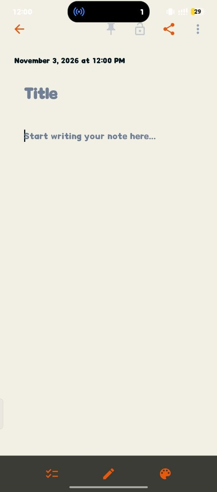

# 📝 Notezy

### Your thoughts, organized in one place.

Notezy is a mobile notes application designed to make capturing, finding, and managing everyday notes simple. It combines a clean writing experience with note organization and privacy-focused features.

---

## 📱 Screenshots

<p align="center">
  
  &nbsp;&nbsp;&nbsp;
  
</p>

<p align="center">
  <sub>Notes home screen · Note editor</sub>
</p>

---

## ✨ Features

- **Create and edit notes** — capture ideas and update them whenever needed.
- **Search notes** — find notes using the search field.
- **Locked notes** — protect private notes with a passcode.
- **Pin and share controls** — access note actions from the editor.
- **Checklist and formatting tools** — use the editor toolbar to work with your notes.
- **Theme customization** — access the color palette from the editor.
- **Organized note cards** — scan note titles and previews from the home screen.

---

## 🎨 Interface

Notezy uses a dark notes-list screen with warm, light-colored note cards and an orange accent. The editor uses a calm light background to keep the writing area clear and readable.

---

## 🛠️ Technology

Technology and framework details will be added here once the project's current dependencies and setup are confirmed.

---

## 🚀 Getting Started

Clone the repository:

```bash
git clone https://github.com/Andinet2123/Notezy.git
cd Notezy
```

Install dependencies and run the application using the instructions for the framework configured in this repository.

---

## 👨‍💻 Developer

**Andinet Yohannes**

[GitHub: @Andinet2123](https://github.com/Andinet2123)

---

<p align="center">
  Made with ❤️ by <a href="https://github.com/Andinet2123">Andinet Yohannes</a>
</p>
