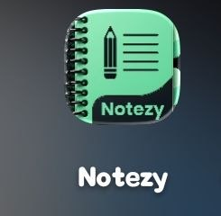
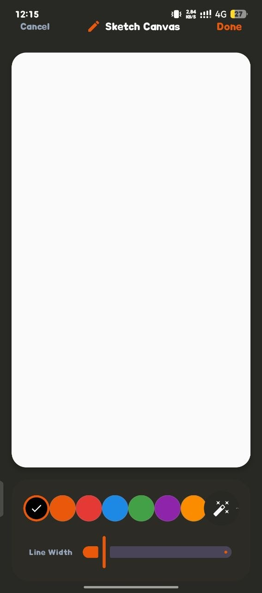
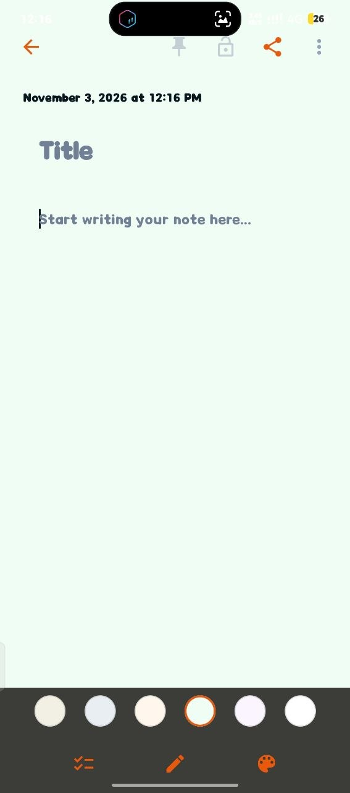

<p align="center">
  
</p>

<h1 align="center">Notezy</h1>
<p align="center"><strong>Your thoughts, organized in one place.</strong><br/>
A modern mobile notes app for capturing ideas, writing freely, and keeping notes organized.</p>

---

## 📱 Screenshots

<p align="center">
  
  &nbsp;&nbsp;
  
</p>
<p align="center"><sub>Home screen · Note editor</sub></p>

<p align="center">
  
  &nbsp;&nbsp;
  
</p>
<p align="center"><sub>Sketch canvas · Editor themes</sub></p>

---

## ✨ Features

- **Create and edit notes** — capture ideas and update them whenever needed.
- **Search notes** — find notes using the search field.
- **Locked notes** — protect private notes with a passcode.
- **Pin and share controls** — access note actions from the editor.
- **Sketch canvas** — draw with selectable colors and adjustable line width.
- **Editor themes** — choose from different writing-area background colors.
- **Checklist tools** — organize tasks with checklists.
- **Clean interface** — a simple layout designed to keep writing front and center.

## 🎨 Design

Notezy combines a dark notes-list interface, warm note cards, and orange accents. The editor offers calm, light backgrounds, with theme options to personalize the writing space.

## 🛠️ Technology

Add the actual framework, programming language, and storage technology used by this repository here.

## 🚀 Getting Started

```bash
git clone https://github.com/Andinet2123/Notezy.git
cd Notezy
```

Install dependencies and run the application using the setup instructions for the framework used in this project.

## 👨‍💻 Developer

**Andinet Yohannes** · [GitHub: @Andinet2123](https://github.com/Andinet2123)

<p align="center">Made with ❤️ by <a href="https://github.com/Andinet2123">Andinet Yohannes</a></p>
